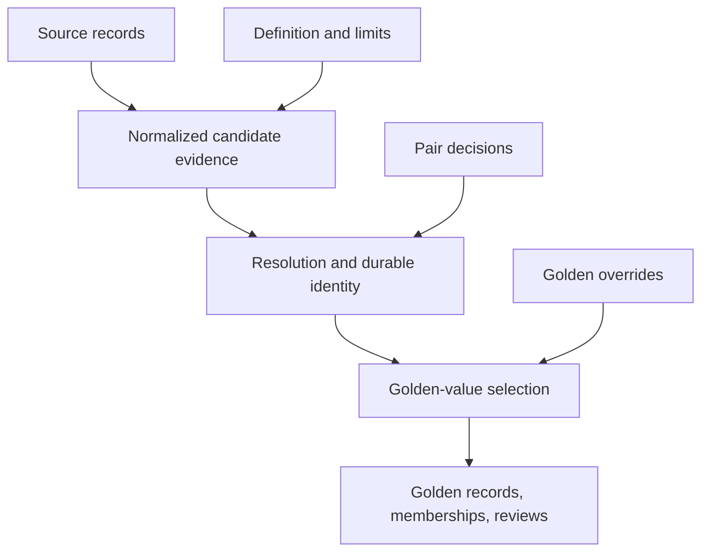

# How entity resolution works

[Documentation home](../README.md) · Explanation

Entity resolution starts with a simple distinction: a row describes something, but the row is not necessarily the thing itself. A customer can appear in a CRM, a billing system, and a support database, each with its own key, spelling, and update history. pg_mdm retains those source records and resolves them into entities. A golden record is the selected set of field values that applications can use for one resolved entity; it is accompanied by membership and review information so the result can be examined rather than accepted on faith.

## From source records to a publication

The work separates naturally into maintaining evidence and deciding what that evidence means. pg_trickle maintains pg_mdm's private relational graph of normalized records, candidate pairs, and comparisons. pg_mdm applies the resolution policy, durable steward decisions, identity reconciliation, and golden-value selection. The publication transaction connects those stages so a consumer sees a coherent result.

The five definition nouns describe this work without requiring an application to manage the graph's private tables. A `source` maps existing columns, a `field` gives shared meaning and cleaning, a `match` describes evidence, a `golden_value` chooses a published value, and an `entity` collects those choices into one named definition. The [first tutorial](../tutorials/first-entity.md) keeps each choice visible in a single SQL statement.

## Cleaning makes agreement meaningful

Consider `accounts@acme.example` and ` ACCOUNTS@ACME.EXAMPLE `. The email cleaner makes their comparison values agree, while the selected golden value can still preserve the source's original representation. This is useful because normalization and presentation answer different questions. Normalization asks whether two inputs have the same defined comparison meaning; presentation asks which usable value a reader should see. A cleaner is therefore neither a source-data update nor a universal repair for poor data quality.

Missing and malformed values also need meaning. The normalization layer distinguishes absent, empty, invalid, unknown, redacted, and unsupported states from a usable value. Only the usable `value` state supplies comparison evidence. Without that distinction, two blank email fields could become a strong-looking agreement simply because they are both blank. The current [cleaner reference](../reference/definitions.md#cleaners) identifies each supported transformation and its limits.

## Candidates define the scope of a rule

Comparing every possible pair grows expensive as a dataset grows, so a candidate predicate describes where a rule will look. An exact email channel gathers records with the same normalized email. A name-prefix channel admits records sharing the chosen prefix before a fuzzy comparator examines their full names. The candidate predicate is part of the semantics: a four-character prefix can exclude a genuine duplicate whose first character was mistyped, regardless of how generous the later similarity threshold is.

pg_mdm treats complete evaluation inside that declared boundary as a correctness requirement. If a common value creates an oversized block or the complete candidate set exceeds its limit, refresh fails and the previous publication remains available. Silently keeping only a convenient subset would turn unexamined pairs into apparent nonmatches. Raising a bound may be appropriate after measurement, but a large shared block often deserves a better definition rather than a larger machine.

## Pair agreement and group agreement are different

A convincing match between two isolated records is not automatically enough to join two established groups. Shared contact details, reused identifiers, and family or company relationships can form chains that connect unrelated entities. The current conservative admission policy makes larger joins require stronger support. A singleton is one record; an established component already contains more than one record. The table below describes automatic admission after pair evaluation, with cannot-link constraints, authoritative conflicts, and resource limits still taking precedence.

| Proposed join | Required automatic support |
| --- | --- |
| Singleton to singleton | An identity or strong automatic pair result. |
| Singleton to established component | An identity pair result, or a strong connection corroborated by an independent agreeing evidence group. |
| Established component to established component | Shared authority, or at least two distinct strong pair connections with independent evidence-group sets. |

Two groups on the same pair do not satisfy the last row's requirement for two distinct connections. The implemented checks are in [src/resolver.rs](../../src/resolver.rs), their stable policy names are in [resolver admission](../../src/resolver/admission.rs), and the retained semantic manifest is visible through `mdm.describe()`.

Evidence groups prevent repeated versions of one fact from appearing to be independent support. For example, exact and fuzzy comparisons derived from the same name are still evidence from the same underlying name lineage. A definition that spreads one lineage across independent groups is rejected. A supporting rule can add context without independently creating a candidate or proving identity. These choices keep a plausible pairwise similarity from becoming an unchecked transitive merge.

## Human instructions belong in the model

Sometimes a steward knows that two records refer to the same customer, or that a shared email belongs to different customers. `MATCH` and `NOT_MATCH` instructions preserve that judgment with a reason and a version. Cannot-link constraints apply across components, so a chain of manual matches cannot quietly join two records already constrained apart. A contradictory instruction is rejected, leaving the previous coherent decision state intact.

Golden overrides answer a separate question: which field value should be published for the entity containing an anchor source record? They do not assert that another record belongs to that entity. Keeping pair decisions and value directives separate makes the [second tutorial](../tutorials/inspect-and-refine.md) possible: the published name changes while the matching evidence, memberships, and customer identity remain the same.

## Reviews are part of the useful result

A review represents a condition that deserves attention, such as uncertainty or conflict, rather than an exception that an application should hide. The review table retains open and resolved occurrences, while `has_review` gives consumers a convenient published indicator. Your application can decide which actions are appropriate for reviewed entities and route cases to a person or a bounded policy workflow.

The current explanation API provides detailed retained pair facts and current identity status; it does not yet provide populated golden, source-record, review, or publication fact lists despite accepting those subject shapes. Use the [output reference](../reference/outputs.md#explanation-subjects) to choose the evidence surface that is actually implemented. That boundary matters when building a user interface: an empty accepted response should never be presented as proof that there was no provenance or no reason for the result.

**Continue with:** [Publication and durable identity](publication-and-identity.md), or [Model your own sources](../how-to/model-sources.md).
